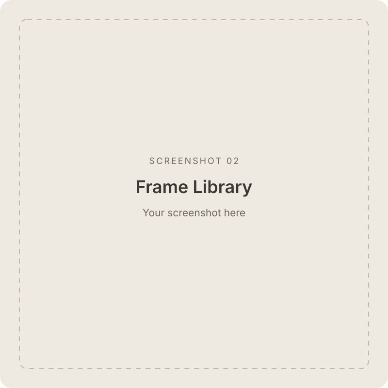

# Framed

  Create App Store screenshots in a native Mac app.

Framed turns screenshots from your device or simulator into finished images for the App Store. Add a device frame, choose a background, write a headline, and export your screenshots at the size you need. Everything happens locally on your Mac.

  
  
  

*App screenshots coming soon.*

## Features

- **Bring your own frames.** Import front-facing, transparent PNG device frames. Framed detects the screen opening and preserves the bezel and camera cutouts.
- **Import once, reuse later.** Keep frames in a reusable library with visual previews, search, one-click Watch, iPhone, iPad, and Mac filters, renaming, and bulk management.
- **Match your canvas.** Selecting a frame chooses a canvas from the matching device family. You can change the size and orientation afterward.
- **Organize by device.** Keep iPhone, iPad, Mac, Apple Watch, and Apple TV screenshots in collapsible sections, each with a default layout for new imports. Add multiple sections for the same device, such as iPad Portrait and iPad Landscape, and rename or duplicate their layouts.
- **Give every screenshot its own layout.** Choose a separate frame, background, headline, position, and effects for each image. Duplicate screenshots, reorder them, or copy a style across your set.
- **Add a headline.** Use up to two lines of text with your choice of font, size, weight, color, and position.
- **Style the scene.** Choose a background color or transparency, add a corner glow, and fade the device into the background.
- **Make Mac windows feel at home.** Place a window capture on a gradient desktop inside a Mac frame, with adjustable window size, position, and shadow.
- **Arrange with precision.** Move the device and headline on the canvas, use center guides and snapping, and zoom or pan to inspect the details.
- **Export your way.** Save PNG or JPEG, adjust JPEG quality, choose a canvas size and scale, and export one image, the current device, or the entire project into a folder you choose. Entire projects are organized into device folders.
- **Pick up where you left off.** Save a portable `.framed` project package containing your original screenshots, frames, and layouts. Undo and redo edits, and get a save prompt before closing unsaved work.

## Getting started

1. **Add a device** with the sidebar toolbar’s **+** menu and set its **Default Layout**, or import screenshots to get started. You can also drag screenshots from Finder into the sidebar.
2. **Choose a device frame** in Frame Library, or choose **No frame** to work with the screenshot alone. You can also choose a frame before importing a screenshot.
3. **Make it yours.** Adjust the background and device position, add a headline, and try the optional effects. Your changes belong to the selected screenshot.
4. **Check the canvas.** Framed selects a matching device-family preset when you choose a frame. Review the final size in **Device & Canvas**.
5. **Export.** Open Export in the toolbar, choose PNG or JPEG, set the size and quality, and select where to save. Choose **Current Device** or **Entire Project** to export a set in sidebar order.
6. **Save your project** with **⌘S** to continue later. Exporting images and saving a project are separate actions.

## Getting device frames

Framed does not include or redistribute Apple device artwork. Get device bezels directly from [Apple Design Resources](https://developer.apple.com/design/resources/), then import transparent PNGs into Frame Library. If the download contains design files, export the frames you need as transparent PNGs first.

Use a front-facing frame that matches your screenshot’s device and orientation. The screen opening and the area outside the device should be transparent. Automatic screen detection works best; manual screen-edge adjustments are available when needed.

## Exporting for the App Store

Framed includes canvas presets for iPhone, iPad, Mac, Apple Watch, and other Apple platforms, with a link to [Apple’s screenshot requirements](https://developer.apple.com/help/app-store-connect/reference/app-information/screenshot-specifications).

- Use an **opaque background** for App Store uploads. Transparent PNGs are available for other uses.
- Leave export scale at **100%** to retain the selected canvas dimensions.
- **Fit** keeps the whole screenshot; **Fill** crops it to cover the screen opening.
- Each screenshot keeps its own layout when you export the whole set.

## Shared styles

Select **Project Style** at the top of the sidebar to set one headline and effects style across your devices. New devices and screenshots follow it automatically. Headline size scales with each canvas, while placement stays local.

Use **Apply to All** to link existing layouts to the project style. To make an exception, turn off **Use Project Style** on a device or **Use Device Style** on a screenshot, separately for Headline and Effects. Turn it back on to follow the shared style again. Existing projects keep their current styles until you choose to link them.

## Projects and privacy

Screenshots and frames are processed locally. Framed does not upload them to a server.

A `.framed` project is a package containing your original image files and layouts. It appears as one document in Finder, so you can move it without keeping track of the source files. Older projects still open and switch to the package format when saved; images already stored in those projects keep their existing format. Imported frames are also stored in the app’s local library for reuse across projects. Adding frames to that library does not mark your project as changed.

## Requirements

- macOS 26.0 or later
- Screenshots from a real device or simulator
- Optional front-facing device frames in transparent PNG format

## Handy shortcuts

| Action | Shortcut |
| --- | --- |
| Add screenshots | ⌘I |
| Open project | ⌘O |
| Save project | ⌘S |
| Save project as | ⇧⌘S |
| Export | ⌘E |
| Undo / redo | ⌘Z / ⇧⌘Z |
| Fit canvas to the window | ⌘0 |

---

Development and verification notes are in [Notes/Development.md](Notes/Development.md).
